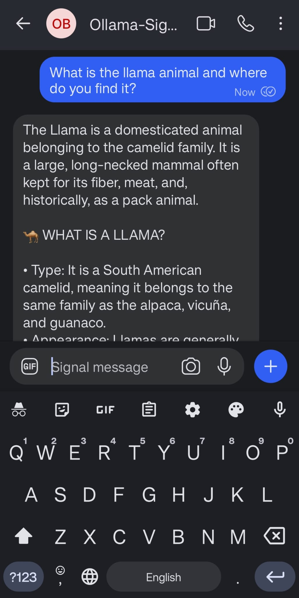
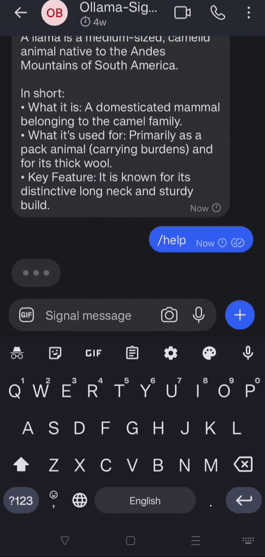

# 🤖 Ollama Signal Bot

[](LICENSE)
[](https://www.python.org/)
[](https://docs.docker.com/get-docker/)
[](https://github.com/kasp0r/ollama-signal-bot/actions/workflows/ci.yml)

A self-hosted Signal bot that forwards your messages to a local [Ollama](https://ollama.com) model and replies with AI-generated answers — privately. No cloud APIs, no subscriptions, and no data leaves your network. Built on [signal-cli-rest-api](https://github.com/bbernhard/signal-cli-rest-api) and containerized with Docker.

<p align="center">
  
</p>

> [!TIP]
> Use a **separate phone number** dedicated to the bot, so your personal Signal account stays untouched.

> [!IMPORTANT]
> **Attribution:** This project is built on [signal-cli-rest-api](https://github.com/bbernhard/signal-cli-rest-api) (GPL-3.0) and [Ollama](https://ollama.com) (MIT). See [NOTICE](NOTICE) for full license details.

## Table of contents

- [Features](#features)
- [Quick start](#quick-start)
- [Dedicated Signal number](#dedicated-signal-number)
- [Configuration](#configuration)
- [Managing the bot](#managing-the-bot)
- [Web UI](#web-ui)
- [Bot commands](#bot-commands)
- [How it works](#how-it-works)
- [Privacy](#privacy)
- [Security](#security)
- [Troubleshooting](#troubleshooting)
- [Attribution & license](#attribution--license)
- [Alternative projects](#alternative-projects)

## Features

- 💬 **Conversational AI** — chat with any Ollama model from Signal
- 🧠 **Conversation memory** — per-user history with configurable depth
- 🔄 **Model switching** — change models on the fly via slash commands
- 📊 **Telemetry mode** — token counts, speed, and timing per response
- 🔒 **Sender allowlist** — restrict access to specific numbers
- 📡 **Auto-detection** — finds available Ollama models at startup
- 🖥️ **Web UI** — configure the bot at runtime from a browser

## Quick start

**Prerequisites**

- [Docker](https://docs.docker.com/get-docker/) + Docker Compose
- [Python 3.10+](https://www.python.org/) (for the setup script only — no `pip install` needed)
- A **dedicated Signal number** registered on a phone (see [below](#dedicated-signal-number))

**Install**

```bash
git clone https://github.com/kasp0r/ollama-signal-bot.git
cd ollama-signal-bot
python setup.py
```

`setup.py` is interactive and asks only a handful of questions:

1. **Ollama** — if you already run Ollama, it's detected and reused automatically; otherwise the script bundles one in Docker for you.
2. **Phone number** — optional; if you leave it blank, it's auto-detected after you link your Signal account.
3. **Model** — which Ollama model to use (defaults to `gemma4:latest`).
4. **System prompt** and **allowed senders** — both optional, with sensible defaults.

It then builds and starts the containers, shows a **QR code** to link your Signal account, and starts the bot.

That's it — send a message to the bot's number and it replies.

<p align="center">
  
</p>

**[📹 Watch the full demo video](./asset/ollama-signal-bot-demo-android.mp4)**

## Dedicated Signal number

The bot runs as a *linked device* on its own number (like Signal Desktop), so your personal account stays on your phone.

1. **Get a second number** — a second SIM/eSIM, or a VoIP number that can receive SMS once for initial registration.
2. **Install Signal on that number** — e.g. a spare device, or a cloned app on Android via [App Cloner](https://appcloner.app/).
3. **Link the bot** — open the web UI (`http://127.0.0.1:8000`) and scan the QR code with the cloned app: **Settings → Linked Devices → +**. (Or run `python setup.py`, which does the same.)

The app remains the primary device; the bot is linked to it and must stay installed.

## Configuration

`setup.py` writes `.env` for you. To edit it by hand instead, copy `.env.example` to `.env`:

| Variable | Required | Default | Description |
|---|---|---|---|
| `SIGNAL_PHONE_NUMBER` | No | auto-detect | The bot's Signal number (auto-detected after linking) |
| `OLLAMA_URL` | No | `http://ollama:11434` | Ollama URL (see below) |
| `OLLAMA_MODEL` | No | auto-detect | Model name (e.g. `gemma4:latest`) |
| `OLLAMA_TEMPERATURE` | No | `0.7` | Sampling temperature (0.0-1.0) |
| `SYSTEM_PROMPT` | No | `You are a helpful assistant.` | System prompt for every reply |
| `ALLOWED_SENDERS` | No | `*` | `*` = everyone, or comma-separated numbers |
| `ALLOWED_ADMINS` | No | `*` | Who can run admin commands (`*` = everyone, or numbers) |
| `WEBUI_TOKEN` | No | (none) | Secret required to use the web UI (empty = no auth) |
| `WEBUI_PORT` | No | `8000` | Host port for the web UI |

### Ollama: Docker or your own?

By default the bot uses a **bundled Ollama** (`http://ollama:11434`) — nothing to install. Pull models into it with:

```bash
docker compose --profile ollama exec ollama ollama pull gemma4:latest
```

If you already run Ollama, `setup.py` detects it and switches to `http://host.docker.internal:11434` automatically (this works on Linux, macOS, and Windows). You then manage models with your normal `ollama pull` command.

> **GPU:** the bundled Ollama runs on CPU by default. To use your NVIDIA GPU, uncomment the `deploy` block in `docker-compose.yml`.

## Managing the bot

```bash
docker compose logs -f ollama-signal-bot   # follow logs
docker compose restart ollama-signal-bot    # restart the bot
docker compose down                         # stop (add --profile ollama to stop bundled Ollama too)
git pull && docker compose build && docker compose up -d   # update to the latest code
```

`docker compose ps` shows a health status for the bot (healthy/unhealthy).

These commands are also available as `make` shortcuts — run `make` to list them all: `make up`, `make down`, `make logs`, `make restart`, `make test`, `make model-pull MODEL=...`, and more.

## Web UI

The bot serves a web UI for configuration and monitoring. Open it at:

```
http://127.0.0.1:8000
```

It shows the status of the bot and its dependencies (signal-api, Ollama, and
the linked Signal account), lets you **link the account on first run** by
scanning the QR code, and lets you change the model, temperature, system
prompt, history limit, and allowlists — changes apply immediately and persist
across restarts (stored in the `bot-data` volume).

By default the UI is bound to `127.0.0.1` (localhost only). To require a
password, set `WEBUI_TOKEN` in `.env`; the UI will then prompt for it.

## Bot commands

Send any of these to the bot's number (one-to-one chats only — group messages are ignored):

| Command | Description |
|---|---|
| `/help` | Show all commands |
| `/heartbeat` | Uptime, service status, and stats |
| `/version` | Ollama server version |
| `/list` | List available models |
| `/model` / `/model <name>` | Show / switch the active model |
| `/ps` | List running models |
| `/show <name>` | Model details |
| `/reset` | Clear your conversation history |
| `/history` | Conversation stats |
| `/recent` / `/recent <n>` | Show recent conversation messages |
| `/maxhistory` / `/maxhistory <n>` | Show / set memory limit (pairs) |
| `/verbose` | Toggle response telemetry |
| `/config` | Show current settings |

> **Admin-only:** `/model <name>`, `/maxhistory <n>`, and `/config` require the sender to be in `ALLOWED_ADMINS`.

With `/verbose` enabled, each reply includes telemetry:

```
─── Telemetry ───
  Model: gemma4:latest
  Input tokens: 142 (0.35s | 405.7 t/s)
  Output tokens: 87 (1.24s | 70.2 t/s)
  Model load: 0.02s
  Total time: 1.61s
```

## How it works

```
Signal app  ⇄  signal-cli-rest-api  ⇄  bot  ⇄  Ollama
 (phone)        (Docker · decrypts)   (Docker)  (LLM)
```

1. A message arrives via Signal's end-to-end encryption and is **decrypted locally** by signal-cli-rest-api using your linked device's keys.
2. The bot polls the REST API (`http://localhost:18080`) for new messages.
3. It sends the message (plus conversation history) to Ollama and returns the reply.

## Privacy

- Messages are decrypted on your machine only; plaintext travels over the **local Docker network** and never touches the internet.
- **Conversation history is in memory only** — never written to disk, cleared on restart or `/reset`.
- The only persisted data is your Signal device keys (`signal-cli-data` volume) and the Ollama model files.

## Security

- **Localhost-only ports** — the Signal API and Ollama bind to `127.0.0.1`, so they're not exposed to your LAN.
- **Sender allowlist** (`ALLOWED_SENDERS`) — controls who can message the bot.
- **Admin allowlist** (`ALLOWED_ADMINS`) — controls who can change models, limits, and view config.
- **Rate limiting** — 10 messages per minute per sender.
- **Message length caps** — prompts and responses are truncated to avoid abuse.
- **Non-root container** — the bot runs as an unprivileged user.

## Troubleshooting

| Problem | Fix |
|---|---|
| Bot can't reach Ollama | Check `OLLAMA_URL` in `.env`. Use `host.docker.internal:11434` (host Ollama) or `http://ollama:11434` (bundled). |
| `Receive failed (account not registered?)` | Re-run `python setup.py` and complete the QR linking; ensure the cloned Signal app is still installed. |
| `No model is currently loaded` | Pull a model: `ollama pull gemma4:latest` (or `docker compose --profile ollama exec ollama ollama pull ...`). |
| Port 18080 in use | Change the host port in `docker-compose.yml` (e.g. `"19080:8080"`), then set `SIGNAL_API_URL=http://localhost:19080` when linking. |
| Messages not received | `docker compose logs -f ollama-signal-bot` and check `http://localhost:18080/v1/about`. |

## Attribution & license

- [signal-cli-rest-api](https://github.com/bbernhard/signal-cli-rest-api) — **GPL-3.0**
- [Ollama](https://ollama.com) — **MIT**
- Python dependencies (`httpx`, `python-dotenv`) — **BSD-3-Clause**

See [NOTICE](NOTICE) for full details. This project itself is licensed under the [MIT License](LICENSE).

## Alternative projects

| Project | Highlights |
|---|---|
| [Signallama](https://github.com/aljazceru/signallama) | Simple dedicated Signal ↔ Ollama chat |
| [uoltz](https://github.com/maciejjedrzejczyk/uoltz) | Local-first bot with skills & voice |
| [Signal-to-Ollama Bridge](https://github.com/asynchronous-x/signal-to-ollama-bridge) | Minimal Express.js bridge |
| [Clawdbot/OpenClaw](https://github.com/OpenClaw) | Multi-platform framework |
| [Signal Bot Crawly](https://github.com/hajekad/signal-bot-crawly) | Rust, groups & summarization |

---

**Author:** Rudi Ball

See [CHANGELOG.md](CHANGELOG.md) for a full history of changes.
